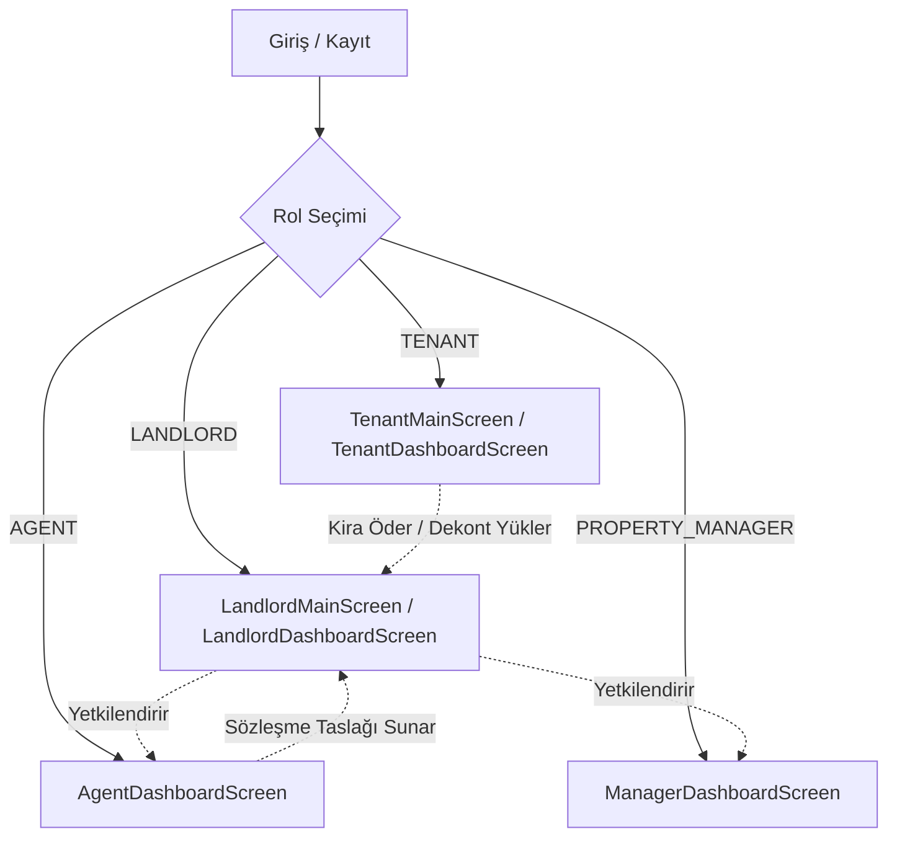
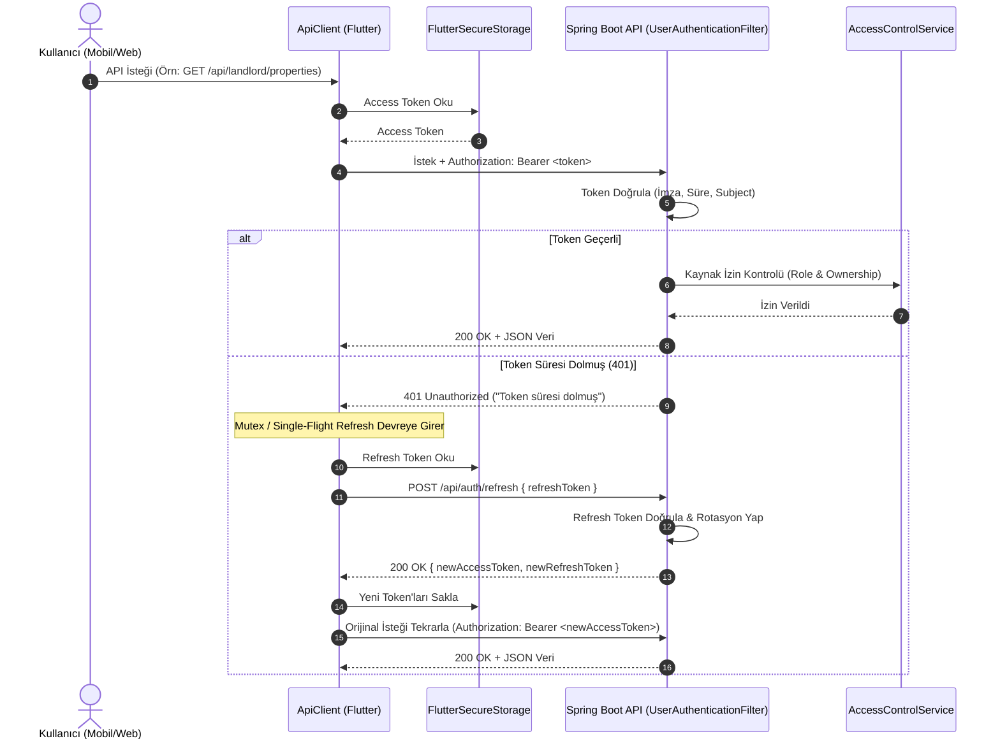

# KiraZ PropTech B2B Platformu - Kapsamlı Mimari ve Geliştirici El Kitabı

Bu belge, **KiraZ** uygulamasının mimari yapısını, iş mantığını, güvenlik modelini, veri modellerini, servis katmanını ve ekran akışlarını hiç bilmeyen bir mühendisin projeye anında adapte olup üzerine geliştirme yapabilmesi amacıyla hazırlanmıştır.

---

## 1. Proje Vizyonu ve Evrimi

### 1.1. C2C'den Kurumsal B2B PropTech Ekosistemine Dönüşüm
KiraZ, başlangıçta bireysel ev sahiplerinin kiracılarını ve kira günlerini manuel takip ettiği bir C2C MVP olarak tasarlanmıştır. Geliştirme süreci boyunca proje; profesyonel emlak ofisleri (**AGENT**), kurumsal portföy yöneticileri (**PROPERTY_MANAGER**), gayrimenkul yatırımcısı ev sahipleri (**LANDLORD**) ve kiracıların (**TENANT**) ortak çalıştığı çok rollü bir **B2B SaaS PropTech Platformu**na dönüştürülmüştür.

### 1.2. Temel Değer Önerileri
- **Emlak Danışmanı / Mülk Yöneticisi Entegrasyonu:** Ev sahipleri mülklerinin kiralama ve operasyonel yetkisini emlakçılara ve kurumsal mülk yöneticilerine güvenli ve süreli olarak delege edebilir.
- **Maker-Checker Güvenlik Modeli:** Emlakçılar sözleşme hazırlayabilir; ancak bu sözleşmeler ev sahibi tarafından onaylanmadıkça kiracı tarafından aktif edilemez ve yürürlüğe girmez.
- **Çift Kanallı Finansal Tahsilat Altyapısı:**
  - **Sanal POS (PayTR):** Kiracılar kredi kartıyla iFrame üzerinden 3D Secure ile güvenli ödeme yapabilir (HMAC hash doğrulamalı webhook callback).
  - **Havale/EFT & Dijital Kasa (Vault):** Kiracılar banka havalesi yapıp dekont yükler (Yalnızca PDF, JPEG, PNG kabul edilir; magic bytes doğrulaması); ev sahibi dekontu inceleyip onaylar veya ret gerekçesiyle reddeder.
- **Finansal Sağlık & Analitik Gösterge Paneli:** Son 6 aylık gelir grafiği, doluluk oranları, yaklaşan sözleşme bitişleri ve DASK poliçe alarmları.

---

## 2. Teknoloji Yığını ve Altyapı

| Alan | Teknoloji / Kütüphane | Kullanım Amacı |
| :--- | :--- | :--- |
| **Mobil/Web İstemci** | Flutter (SDK ^3.13.5, Dart 3.x) | iOS, Android ve Web çok platformlu istemci |
| **Tasarım Dili** | Özel Vanilla Design System (Material 3) | Fildişi (`#FBF8F1`), Gece Mavisi (`#161F33`), Kobalt Mavi (`#1E50CE`) |
| **Tipografi** | `google_fonts` (^6.2.1) | Poppins (Başlıklar ve Rakamlar) & Inter (Gövde Metinleri) |
| **Grafik & Veri Görselleştirme**| `fl_chart` (^1.3.0) | Dinamik 6 aylık bar grafikleri ve finansal trendler |
| **Ödeme Ağ Geçidi** | `webview_flutter` (^4.14.1) | PayTR iFrame tabanlı güvenli Sanal POS ödeme ekranı |
| **Dosya & Medya Yönetimi** | `image_picker`, `file_picker`, `http_parser` | Dekont ve sözleşme belgelerinin (PDF, JPEG, PNG) yüklenmesi |
| **Güvenli Saklama** | `flutter_secure_storage` (^9.2.4) | JWT Access ve Refresh token'ların işletim sistemi anahtarlığında (Keychain/Keystore) şifreli saklanması |
| **Ağ Katmanı** | `http` (^1.6.0) & Merkezi `ApiClient` | Bearer token ekleme, 401 durumunda otomatik tekil token yenileme (single-flight mutex) |
| **Backend Framework** | Spring Boot 3.x (Java 17+) | REST API, Spring Security, Stateless JWT filtreleri |
| **Veritabanı & Migration** | PostgreSQL 15 & Flyway | İlişkisel veri saklama, sürüm kontrollü veri göçü (V1..V4) |
| **Olay Akışı & Mesajlaşma** | Apache Kafka & Confluent Zookeeper | Ödeme olayları (`payment-events`) ve denetim logları asenkron akışı |
| **Loglama & Gözlemlenebilirlik**| Elasticsearch 8.x, Logstash, Kibana | Merkezi loglama ve denetim izleme |

---

## 3. Kullanıcı Rolleri ve Yetki Matrisi

Uygulama 4 temel aktör üzerine inşa edilmiştir:

| Rol Kodu | Tanım | Temel Yetki ve Ekranlar |
| :--- | :--- | :--- |
| **`LANDLORD`** | Ev Sahibi | Mülk ekleme ve güncelleme (`PUT /api/properties/{id}`), portföy takibi, emlakçı yetkilendirme (`POST /api/landlord/delegations`), sözleşme onaylama/reddetme, davet kodu yenileme (`POST /api/landlord/leases/{id}/regenerate-invite`), tahsilat onaylama (`POST /api/landlord/receipts/{periodId}/approve`), finansal analitikler. |
| **`TENANT`** | Kiracı | Aktif sözleşme detayı, ödeme planı ve geçmişi (`GET /api/tenant/payments/summary`), PayTR kredi kartı ödemesi, Havale/EFT dekont yükleme (`POST /api/tenant/receipts/{periodId}`), sözleşmeyi kabul etme (`POST /api/leases/accept`). |
| **`AGENT`** | Emlak Danışmanı | Yetkili olduğu mülkler için taslak sözleşme oluşturma (`POST /api/leases`), davet kodu ile kayıt olma, emlakçı gösterge paneli (`GET /api/manager/dashboard`). |
| **`PROPERTY_MANAGER`** | Kurumsal Mülk Yöneticisi | Kendisine devredilmiş portföyü yönetme (`GET /api/manager/properties`), sözleşme durumlarını izleme, operasyonel süreç takibi (`GET /api/manager/dashboard`). |

---

## 4. Temel Modüller ve Güvenlik Mimarisi

### 4.1. JWT Kimlik Doğrulama ve Token Yaşam Döngüsü

Sistemde oturum yönetimi tamamen **stateless JWT** üzerine kuruludur. İstemci kimliği istek başlıklarındaki `Authorization: Bearer <access_token>` üzerinden belirlenir; gövde veya `X-User-Id` gibi güvenilmeyen başlıklara asla itibar edilmez.

#### Token Özellikleri
- **Access Token:** 15 dakika geçerlidir. Algoritma: HMAC-SHA512. Claims: `sub` (kullanıcı ID), `role`, `email`, `fullName`.
- **Refresh Token:** 14 gün geçerlidir. Veritabanında SHA-256 özeti (`token_hash`) saklanır.
- **Rotasyon & Yeniden Kullanım Tespiti (Reuse Detection):** Her refresh isteğinde mevcut token iptal edilir ve yeni bir çift üretilir. Eğer daha önce kullanılmış bir refresh token ile istek gelirse, sistem bir çalınma atağı kabul ederek o kullanıcıya ait tüm aktif oturumları anında sonlandırır.
- **Frontend Single-Flight Mutex:** Eşzamanlı gelen birden fazla istek 401 aldığında yalnızca tek bir refresh isteği tetiklenir; diğer istekler bu yenilemeyi bekleyip yeni token ile yinelenir.

---

### 4.2. Kaynak Bazlı Yetkilendirme (IDOR Koruması)
Backend'deki tüm erişim kontrolleri `AccessControlService` (`@Component("authz")`) tarafından sağlanır:
- Ev sahibi yalnızca kendi mülklerine (`landlordId == token.userId`) ve bunlara ait sözleşmelere erişebilir. Başka ev sahibinin mülküne erişim denendiğinde bilgi sızdırmamak adına **404 Not Found** döner.
- Kiracı yalnızca kendi kiraladığı sözleşmeye, dekontlara ve ödeme dönemlerine erişebilir. Başka kiracının dönemine veya dekontuna erişim **404 Not Found** döner.
- `PUT /api/properties/{id}` yalnızca mülkün sahibi olan `LANDLORD` tarafından çağrılabilir (200 OK). Başka ev sahibi için 404 Not Found, emlakçı ve kiracı için **403 Forbidden** döner.

---

### 4.3. Maker-Checker Sözleşme Onay Döngüsü
Emlakçının ev sahibinden habersiz sözleşme yürürlüğe koymasını engeller:
1. **Hazırlık (Agent):** Emlakçı yetkili olduğu mülk için `POST /api/leases` çağırır. Sözleşme durumu `status: PENDING`, onay durumu `approvalStatus: PENDING_LANDLORD_APPROVAL` olarak başlar.
2. **Onay (Landlord):** Ev sahibi `POST /api/landlord/leases/{id}/approve` ile onaylar; `approvalStatus: ACTIVE` olur. Reddetmek isterse `POST /api/landlord/leases/{id}/reject` gerekçe belirterek çağırır.
3. **Kiracı Aktivasyonu:** Kiracı `PUT /api/leases/{id}/activate` çağırır. Eğer ev sahibi onayı henüz yoksa sistem **409 Conflict** döner. Onay sonrasında sözleşme `status: ACTIVE` olur ve kira periyotları türetilir.

---

### 4.4. Davet Kodları ve Hız Sınırı (Rate Limiting)
- Sözleşme davet kodları 128-bit kriptografik entropi ile türetilir (`ARS-` öneki + 32 karakter hexadecimal).
- Kodlar 7 gün geçerlidir ve tek kullanımlıktır.
- Ev sahibi dilerse `POST /api/landlord/leases/{id}/regenerate-invite` ile yeni kod üretebilir; eski kod anında iptal edilir. Kiracısı bağlanmış (ACTIVE) sözleşmelerde kod yenileme **409 Conflict** ile reddedilir.
- `/api/leases/validate-invite` ve `/api/leases/accept` uç noktaları IP başına dakikada maksimum 10 istek kabul eden `InviteRateLimitingFilter` ile korunur; aşımda **429 Too Many Requests** döner.

---

### 4.5. Dosya Yükleme ve Güvenli Stream Mimarisi
- Sözleşme (`POST /api/leases/{id}/contract`) ve dekont (`POST /api/tenant/receipts/{periodId}`) yüklemelerinde yalnızca **PDF**, **JPEG** ve **PNG** kabul edilir.
- Dosya uzantısı manipülasyonunu engellemek için `FileValidationUtil` tarafından dosya başlıkları (Magic Bytes: `%PDF-`, `\xFF\xD8\xFF`, `\x89PNG`) doğrulanır.
- **WEBP**, **TXT** veya çalıştırılabilir dosyalar **400 Bad Request** ile reddedilir.
- Yüklenen dosyalar yerel dosya sisteminde izole UUID adlarıyla saklanır (`uploads/`). Dosyalar doğrudan statik URL üzerinden değil, `FileController` üzerinden kimlik ve yetki doğrulaması yapılarak stream edilir (`GET /api/files/receipts/{periodId}`, `GET /api/files/contracts/{leaseId}`). Token'sız istekler **401**, yetkisiz kiracılar **404** alır.

---

## 5. Veri Modelleri Rehberi

Aşağıdaki modeller `lib/models/` dizininde yer almaktadır:

| Model Dosyası | Alanlar & Amaç |
| :--- | :--- |
| [`property.dart`](file:///Users/okankeles/kiraz-workspace/kiraz_frontend/lib/models/property.dart) | `id`, `title`, `address`, `city`, `daskEndDate`, `status`, `landlordId`. |
| [`lease.dart`](file:///Users/okankeles/kiraz-workspace/kiraz_frontend/lib/models/lease.dart) | `id`, `propertyId`, `tenantId`, `monthlyRentAmount`, `depositAmount`, `startDate`, `endDate`, `status`, `approvalStatus`, `inviteCode`, `contractFileUrl`. |
| [`rent_period.dart`](file:///Users/okankeles/kiraz-workspace/kiraz_frontend/lib/models/rent_period.dart) | `id`, `leaseId`, `month`, `year`, `periodStart`, `paymentDate`, `status` (`PENDING`, `WAITING_APPROVAL`, `PAID`, `OVERDUE`, `IN_LEGAL_PROCESS`), `receiptImageUrl`. |
| [`property_delegation.dart`](file:///Users/okankeles/kiraz-workspace/kiraz_frontend/lib/models/property_delegation.dart) | `id`, `propertyId`, `propertyName`, `agentId`, `agentName`, `agentEmail`, `grantedById`, `status` (`ACTIVE`, `REVOKED`, `EXPIRED`), `startDate`, `endDate`. |
| [`managed_property.dart`](file:///Users/okankeles/kiraz-workspace/kiraz_frontend/lib/models/managed_property.dart) | `id`, `title`, `address`, `landlordName`, `landlordEmail`, `status`. |
| [`payment_summary.dart`](file:///Users/okankeles/kiraz-workspace/kiraz_frontend/lib/models/payment_summary.dart) | `totalDebt`, `totalPaid`, `nextPaymentDate`, `nextPaymentAmount`. |

---

## 6. Kanonik API ve Uç Kataloğu (OpenAPI Kaynaklı)

Aşağıdaki liste doğrudan canlı backend OpenAPI (`/v3/api-docs`) çıktısından üretilmiş 48 kanonik uç noktanın eksiksiz envanteridir. Sistemde hiçbir deprecated veya fallback uç nokta bulunmamaktadır.

### 6.1. Kimlik Doğrulama & Oturum (`Auth`)
| Metot | Yol (Endpoint) | Yetki | Açıklama |
|:---|:---|:---|:---|
| `POST` | `/api/auth/register` | Herkese Açık | Kullanıcı kaydı (LANDLORD, TENANT, AGENT, PROPERTY_MANAGER) |
| `POST` | `/api/auth/login` | Herkese Açık | E-posta ve şifre ile giriş, Access ve Refresh token döner |
| `POST` | `/api/auth/refresh` | Herkese Açık | Refresh token rotasyonu ile yeni token çifti üretir |
| `POST` | `/api/auth/logout` | Herkese Açık | Refresh token'ı veritabanında iptal ederek oturumu kapatır |

### 6.2. Ev Sahibi Modülü (`Landlord`)
| Metot | Yol (Endpoint) | Yetki | Açıklama |
|:---|:---|:---|:---|
| `GET` | `/api/landlord/properties` | `LANDLORD` | Ev sahibine ait mülkleri listeler |
| `GET` | `/api/landlord/dashboard` | `LANDLORD` | Gelir grafiği, doluluk oranı ve yaklaşan sözleşmeler özeti |
| `GET` | `/api/landlord/leases` | `LANDLORD` | Ev sahibinin tüm kira sözleşmelerini listeler |
| `GET` | `/api/landlord/leases/pending-approvals` | `LANDLORD` | Emlakçı tarafından hazırlanmış onay bekleyen sözleşmeler |
| `POST` | `/api/landlord/leases/{id}/approve` | `LANDLORD` | Taslak sözleşmeyi onaylar (`approvalStatus: ACTIVE`) |
| `POST` | `/api/landlord/leases/{id}/reject` | `LANDLORD` | Taslak sözleşmeyi ret gerekçesiyle reddeder |
| `POST` | `/api/landlord/leases/{id}/regenerate-invite` | `LANDLORD` | Bekleyen sözleşme için yeni 128-bit davet kodu türetir |
| `GET` | `/api/landlord/delegations` | `LANDLORD` | Ev sahibinin verdiği emlakçı/yönetici vekaletleri |
| `POST` | `/api/landlord/delegations` | `LANDLORD` | Mülk için yeni emlakçı/yönetici yetkilendirmesi |
| `DELETE` | `/api/landlord/delegations/{id}` | `LANDLORD` | Verilen vekaleti iptal eder |
| `GET` | `/api/landlord/receipts/pending` | `LANDLORD` | Onay bekleyen havale/EFT dekontlarını listeler |
| `POST` | `/api/landlord/receipts/{periodId}/approve` | `LANDLORD` | Havale dekontunu onaylar (`status: PAID`) |
| `POST` | `/api/landlord/receipts/{periodId}/reject` | `LANDLORD` | Havale dekontunu ret sebebiyle reddeder |

### 6.3. Kiracı Modülü (`Tenant`)
| Metot | Yol (Endpoint) | Yetki | Açıklama |
|:---|:---|:---|:---|
| `GET` | `/api/tenant/dashboard` | `TENANT` | Kiracı ana ekranı metrikleri ve yaklaşan ödeme |
| `GET` | `/api/tenant/leases` | `TENANT` | Kiracının dahil olduğu kira sözleşmeleri |
| `GET` | `/api/tenant/payments/summary` | `TENANT` | Toplam borç, ödenen ve sıradaki ödeme özeti |
| `POST` | `/api/tenant/receipts/{periodId}` | `TENANT` | İlgili kira dönemi için dekont yükleme (Multipart) |

### 6.4. Mülk Yöneticisi & Emlakçı Modülü (`Manager`)
| Metot | Yol (Endpoint) | Yetki | Açıklama |
|:---|:---|:---|:---|
| `GET` | `/api/manager/dashboard` | `AGENT`, `PROPERTY_MANAGER` | Yönetici ve emlakçı performans ve portföy özeti |
| `GET` | `/api/manager/properties` | `AGENT`, `PROPERTY_MANAGER` | Yetkili olunan delege mülklerin listesi |
| `GET` | `/api/manager/delegations` | `AGENT`, `PROPERTY_MANAGER` | Tüm vekalet geçmişi |
| `GET` | `/api/manager/delegations/active` | `AGENT`, `PROPERTY_MANAGER` | Yalnızca aktif vekaletler |

### 6.5. Mülk ve Sözleşme Yönetimi (`Properties` & `Leases`)
| Metot | Yol (Endpoint) | Yetki | Açıklama |
|:---|:---|:---|:---|
| `POST` | `/api/properties` | `LANDLORD` | Yeni mülk kaydı oluşturur |
| `GET` | `/api/properties/{id}` | İlgili Roller | Mülk detayını getirir (IDOR korumalı) |
| `PUT` | `/api/properties/{id}` | `LANDLORD` (Sahip) | Mülk bilgilerini günceller (Yalnızca mülk sahibi) |
| `POST` | `/api/leases` | `LANDLORD`, `AGENT` | Yeni sözleşme oluşturur (Emlakçı için maker-checker başlar) |
| `GET` | `/api/leases/{id}` | İlgili Roller | Sözleşme detayını getirir |
| `PUT` | `/api/leases/{id}/activate` | `TENANT` | Kiracı sözleşmeyi aktif eder (Ev sahibi onayı zorunlu) |
| `GET` | `/api/leases/property/{propertyId}` | İlgili Roller | Mülke ait sözleşmeleri listeler |
| `GET` | `/api/leases/validate-invite` | Herkese Açık | Davet kodunu doğrular (Hız sınırlamalı: max 10 istek/dk) |
| `POST` | `/api/leases/accept` | Herkese Açık | Davet kodu ile sözleşmeyi kabul edip şifre belirler |
| `POST` | `/api/leases/{id}/contract` | `LANDLORD`, `AGENT` | Sözleşme PDF belgesi yükler (Multipart) |

### 6.6. Kira Dönemleri, Ödemeler ve Dosya Erişimi
| Metot | Yol (Endpoint) | Yetki | Açıklama |
|:---|:---|:---|:---|
| `GET` | `/api/periods/lease/{leaseId}` | İlgili Roller | Sözleşmeye ait tüm kira takvimi periyotları |
| `GET` | `/api/periods/{id}` | İlgili Roller | Kira dönemi detayı |
| `PUT` | `/api/periods/{id}/legal-process` | `LANDLORD`, `AGENT` | Ödenmeyen kira için hukuki süreç başlatır |
| `POST` | `/api/payments/paytr/initialize` | `TENANT` | PayTR iFrame için tek kullanımlık token alır |
| `POST` | `/api/payments/paytr-callback` | Herkese Açık | PayTR Sanal POS webhook bildirimi (HMAC doğrulamalı) |
| `GET` | `/api/files/receipts/{periodId}` | İlgili Roller | Dekont dosyasını yetkilendirilmiş olarak stream eder |
| `GET` | `/api/files/contracts/{leaseId}` | İlgili Roller | Sözleşme belgesini yetkilendirilmiş olarak stream eder |

### 6.7. Bildirimler ve Denetim İzi (`Notifications` & `Audit Logs`)
| Metot | Yol (Endpoint) | Yetki | Açıklama |
|:---|:---|:---|:---|
| `GET` | `/api/notifications/unread` | Giriş Yapmış | Okunmamış kullanıcı bildirimleri |
| `GET` | `/api/notifications/all` | Giriş Yapmış | Tüm kullanıcı bildirimleri |
| `PUT` | `/api/notifications/{id}/read` | İlgili Kullanıcı | Bildirimi okundu işaretler |
| `GET` | `/api/audit-logs` | İlgili Roller | Varlık bazında denetim geçmişini getirir |
| `GET` | `/api/audit-logs/my-logs` | Giriş Yapmış | Kullanıcının kendi işlem denetim geçmişi |

---

## 7. Tasarım Sistemi ve Renk Paleti ([`AppColors`](file:///Users/okankeles/kiraz-workspace/kiraz_frontend/lib/theme/app_colors.dart))

- **Fildişi Kanvas (Ivory Canvas - `#FBF8F1`):** Açık modda gözü yormayan zemin.
- **Gece Mavisi (Dark Navy - `#161F33` / `#0B1120`):** Koyu tema zemini ve açık tema başlık rengi.
- **KiraZ Kobalt Mavi (`#1E50CE` / `#2563EB`):** Birincil marka aksiyon rengi (Primary Buttons, Aktif Sekmeler, Logo).
- **Zümrüt Yeşili (`#10B981` / `#059669`):** Başarı durumları, onaylanmış ödemeler, aktif sözleşmeler.
- **Kehribar / Turuncu (`#F59E0B` / `#D97706`):** Onay bekleyen dekontlar, yaklaşan sözleşmeler, uyarılar.
- **Gül Pembesi / Kırmızı (`#E11D48` / `#DC2626`):** Gecikmiş ödemeler, ret butonları ve hata mesajları.

---

## 8. Flyway ve Veritabanı Migration Kuralları

KiraZ veritabanı şeması ve kısıtları yalnızca **Flyway** sürümleme mekanizması üzerinden yönetilir. 

### 8.1. Temel Kurallar
1. **Değişmezlik İlkesi (Immutability):** Daha önce commit edilmiş veya çalıştırılmış bir Flyway SQL migration dosyası (`V1`, `V2`, `V3`, vb.) **ASLA DEĞİŞTİRİLEMEZ VEYA SİLİNEMEZ**. Herhangi bir değişiklik dosyanın checksum değerini bozarak uygulamanın ayağa kalkmasını engeller.
2. **İleriye Dönük Sürümleme:** Her yeni şema değişikliği, kısıt ekleme veya veri güncellemesi bir sonraki sürüm numarasıyla (`V5__...sql`, `V6__...sql`) yeni bir dosya olarak `kiraz_backend/src/main/resources/db/migration/` dizinine eklenir.
3. **Check Constraint Yönetimi:** PostgreSQL `CHECK` kısıtları güncellenirken (Örn: `users_role_check` veya `audit_logs_performed_by_role_check`) önce eski kısıt `DROP CONSTRAINT IF EXISTS` ile kaldırılmalı, ardından yeni enum değerlerini içeren kısıt eklenmelidir.
4. **Idempotence & ANSI Standartları:** Migration betikleri ANSI SQL ve PostgreSQL uyumlu olmalı; DDL işlemlerinde veri kaybına yol açmayacak şekilde `IF EXISTS` / `IF NOT EXISTS` kontrolleri içermelidir.

### 8.2. Mevcut Migration Sürümleri
- `V1__baseline.sql`: Ana tabloların oluşturulması (`users`, `properties`, `lease_agreements`, `rent_periods`, `property_delegations`, `refresh_tokens`, `notifications`, `audit_logs`).
- `V2__populate_file_paths.sql`: Dosya yollarının dönüştürülmesi ve aktif sözleşme davet kodlarının güncellenmesi.
- `V3__invalidate_legacy_invite_codes.sql`: Geliştirme ortamı kısa davet kodlarının geçersiz kılınması.
- `V4__add_property_manager_role.sql`: `PROPERTY_MANAGER` kurumsal rolünün veritabanı `users_role_check` ve `audit_logs_performed_by_role_check` kısıtlarına eklenmesi.

---

## 9. Ortam Değişkenleri (.env) Rehberi

Tüm ortam değişkenleri kök dizindeki `.env` dosyasından okunur. Kod içerisine hiçbir parola, token veya sır doğrudan yazılmaz.

| Ortam Değişkeni | Açıklama | Örnek Değer (Dev) |
|:---|:---|:---|
| `DB_URL` | PostgreSQL JDBC bağlantı URL'i | `jdbc:postgresql://localhost:5433/kiraz_db` |
| `DB_USERNAME` | Veritabanı kullanıcı adı | `ars_admin` |
| `DB_PASSWORD` | Veritabanı şifresi | `<Dev-DB-Password>` |
| `DB_PORT` | PostgreSQL host portu | `5433` |
| `DB_NAME` | Veritabanı adı | `kiraz_db` |
| `JWT_SECRET` | HMAC-SHA512 için en az 256-bit base64 anahtar | `<Base64-Secret-Key>` |
| `API_BASE_URL` | İstemcinin bağlanacağı REST API adresi | `http://localhost:8080/api` |
| `SERVER_PORT` | Spring Boot HTTP portu | `8080` |
| `KAFKA_BOOTSTRAP_SERVERS` | Kafka broker adresi | `localhost:9092` |
| `PAYTR_MERCHANT_ID` | PayTR üye işyeri numarası | `659790` |
| `PAYTR_MERCHANT_KEY` | PayTR mağaza gizli anahtarı | `<PayTR-Key>` |
| `PAYTR_MERCHANT_SALT` | PayTR mağaza tuzu | `<PayTR-Salt>` |
| `PAYTR_TEST_MODE` | PayTR test modu (1: Açık, 0: Kapalı) | `1` |
| `SMTP_HOST` / `SMTP_PORT` | E-posta gönderim sunucusu | `smtp.gmail.com` / `587` |
| `DEV_SEED_*_PASSWORD` | Yalnızca dev profili tohumlamasında kullanılan test parolaları | `LandlordPass2026!`, `TenantPass2026!` |

> **Önemli Kural:** Gerçek parolaları içeren `.env` dosyası asla Git sürüm kontrol sistemine eklenmemelidir (`.gitignore` dosyasında yer alır). Yeni bir ortam değişkeni eklendiğinde `.env.example` şablonu güncellenmelidir.
