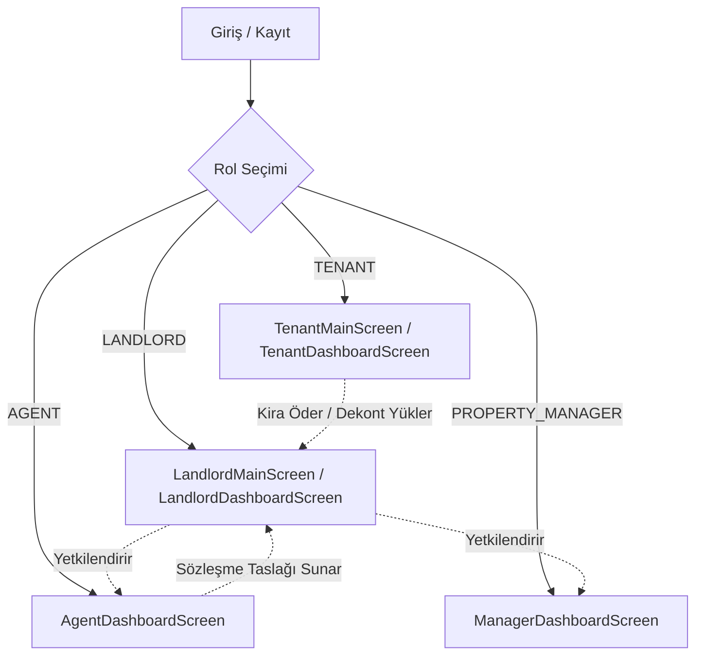

# KiraZ PropTech B2B Platformu - Kapsamlı Mimari ve Geliştirici El Kitabı

Bu belge, **KiraZ** uygulamasının sıfırdan bugüne geçirdiği mimari dönüşümü, iş mantığını, veri modellerini, servis katmanını ve ekran akışlarını hiç bilmeyen bir mühendisin projeye anında adapte olup üzerine geliştirme yapabilmesi amacıyla hazırlanmıştır.

---

## 1. Proje Vizyonu ve Evrimi

### 1.1. C2C'den Kurumsal B2B PropTech Ekosistemine Dönüşüm
KiraZ başlangıçta bireysel ev sahiplerinin kiracılarını ve kira günlerini manuel takip ettiği bir C2C MVP (Minimum Viable Product) olarak tasarlanmıştır. Geliştirme süreci boyunca proje; profesyonel emlak ofisleri (**AGENT**), kurumsal portföy yöneticileri (**PROPERTY_MANAGER**), gayrimenkul yatırımcısı ev sahipleri (**LANDLORD**) ve kiracıların (**TENANT**) ortak çalıştığı çok rollü bir **B2B SaaS PropTech Platformu**na dönüştürülmüştür.

### 1.2. Temel Değer Önerileri
- **Emlak Danışmanı / Mülk Yöneticisi Entegrasyonu:** Ev sahipleri tek tıkla mülklerinin kiralama ve operasyonel yetkisini emlakçılara delege edebilir.
- **Maker-Checker Güvenlik Modeli:** Emlakçılar sözleşme hazırlayabilir; ancak bu sözleşmeler ev sahibi tarafından onaylanmadıkça yürürlüğe girmez.
- **Çift Kanallı Finansal Tahsilat Altyapısı:**
  - **Sanal POS (PayTR):** Kiracılar kredi kartıyla anında iFrame üzerinden 3D Secure ile ödeme yapabilir.
  - **Havale/EFT & Dijital Kasa (Vault):** Kiracılar banka havalesi yapıp dekont yükler; ev sahibi dekontu inceleyip onaylar veya ret gerekçesiyle reddeder.
- **Finansal Sağlık & Analitik Gösterge Paneli:** Son 6 aylık gelir grafiği, doluluk oranları, yaklaşan sözleşme bitişleri ve DASK poliçe alarmları.

---

## 2. Teknoloji Yığını ve Altyapı

| Alan | Teknoloji / Kütüphane | Kullanım Amacı |
| :--- | :--- | :--- |
| **Framework** | Flutter (SDK ^3.13.5, Dart 3.x) | iOS, Android ve Web çok platformlu mobil istemci |
| **Tasarım Dili** | Özel Vanilla Design System (Material 3) | Fildişi (`#FBF8F1`), Gece Mavisi (`#161F33`), Kobalt Mavi (`#1E50CE`) |
| **Tipografi** | `google_fonts` (^6.2.1) | Poppins (Başlıklar ve Rakamlar) & Inter (Gövde Metinleri) |
| **Grafik & Veri Görselleştirme** | `fl_chart` (^1.3.0) | Dinamik 6 aylık bar grafikleri ve finansal trendler |
| **Ödeme Ağ Geçidi** | `webview_flutter` (^4.14.1) | PayTR iFrame tabanlı güvenli Sanal POS ödeme ekranı |
| **Dosya & Medya Yönetimi** | `image_picker`, `file_picker`, `http_parser` | Dekont ve sözleşme belgelerinin (PDF, JPEG, PNG) yüklenmesi |
| **Harici Bağlantılar** | `url_launcher` (^6.3.3) | PDF belgelerini cihazın yerel görüntüleyicisinde açma |
| **Oturum Yönetimi** | `shared_preferences` (^2.5.6) | Kullanıcı ID, e-posta, rol ve token yerel kalıcılığı |
| **Ağ Katmanı** | `http` (^1.6.0) | RESTful API istemcisi, multipart form yüklemeleri ve dayanıklı fallback mekanizmaları |
| **Backend & Tünelleme** | Spring Boot & Ngrok | Canlı demo API sunucusu (`<.env dosyasından API_BASE_URL>`) |

---

## 3. Kullanıcı Rolleri ve Yetki Matrisi

Uygulama 4 temel aktör üzerine inşa edilmiştir:



| Rol Kodu | Tanım | Temel Yetki ve Ekranlar |
| :--- | :--- | :--- |
| **`LANDLORD`** | Ev Sahibi | Mülk ekleme, portföy takibi, emlakçı yetkilendirme (`delegations_screen.dart`), sözleşme onaylama/reddetme, tahsilat onaylama (`receipt_approvals_screen.dart`), finansal grafikler. |
| **`TENANT`** | Kiracı | Aktif sözleşme detayı, ödeme geçmişi ve gelecek ödeme planı (`payments_screen.dart`), PayTR kredi kartı ödemesi (`paytr_payment_screen.dart`), Havale/EFT dekont yükleme (`eft_payment_screen.dart`). |
| **`AGENT`** | Emlak Danışmanı | Kendisine atanan mülkler için sözleşme taslağı oluşturma (`assign_tenant_screen.dart`), referans kodu ile davet alma, performans takibi (`agent_dashboard_screen.dart`). |
| **`PROPERTY_MANAGER`** | Kurumsal Mülk Yöneticisi | Kendisine devredilmiş mülk portföyünü yönetme, ev sahibi iletişim bilgileri ve sözleşme durumlarını tek ekranda izleme (`manager_dashboard_screen.dart`). |

---

## 4. Temel Modüller ve Mimari Detaylar

### 4.1. Yetkilendirme ve Dinamik Rol Yönlendirmesi
- **Giriş Noktası ([`role_selection_screen.dart`](file:///Users/okankeles/kiraz-workspace/kiraz_frontend/lib/screens/auth/role_selection_screen.dart)):** Kullanıcılar `LANDLORD`, `TENANT`, `AGENT` veya `PROPERTY_MANAGER` kartlarından birini seçerek giriş/kayıt akışına yönlendirilir.
- **Referans Kodu Sistemi:** Emlakçılar veya kiracılar davet kodları (`AGT-XXXXXX` veya `REF-XXXXXX`) ile kayıt olabilir.
- **Yönlendirme Merkezi ([`dashboard_screen.dart`](file:///Users/okankeles/kiraz-workspace/kiraz_frontend/lib/screens/dashboard/dashboard_screen.dart)):** Giriş başarılı olduğunda SharedPreferences'taki `role` anahtarına göre ilgili ana ekrana yönlendirilir:
  - `PROPERTY_MANAGER` -> [`ManagerDashboardScreen`](file:///Users/okankeles/kiraz-workspace/kiraz_frontend/lib/screens/manager/manager_dashboard_screen.dart)
  - `AGENT` -> [`AgentDashboardScreen`](file:///Users/okankeles/kiraz-workspace/kiraz_frontend/lib/screens/agent/agent_dashboard_screen.dart)
  - `LANDLORD` -> [`LandlordMainScreen`](file:///Users/okankeles/kiraz-workspace/kiraz_frontend/lib/screens/landlord/landlord_main_screen.dart)
  - `TENANT` -> [`TenantMainScreen`](file:///Users/okankeles/kiraz-workspace/kiraz_frontend/lib/screens/tenant/tenant_main_screen.dart)

---

### 4.2. Emlakçı Yetkilendirme ve Portföy Yönetimi
Ev sahipleri ile emlakçılar arasındaki güvenli bağı kurar.

1. **Ev Sahibi Paneli ([`delegations_screen.dart`](file:///Users/okankeles/kiraz-workspace/kiraz_frontend/lib/screens/landlord/delegations_screen.dart)):**
   - Aktif emlakçı atamalarını listeler (`Mülk Adı`, `Emlakçı Adı/E-postası`, `Durum`).
   - Sağ alttaki FAB ("Yeni Emlakçı Ata") ile Bottom Sheet açılır; mülk dropdown'dan seçilir, emlakçı e-postası girilir.
   - Her kartta bulunan kırmızı çöp kutusu ikonu ile onay alınarak yetki iptal edilir (`DELETE /api/landlord/delegations/{id}`).
   - Başarılı atamalarda emlakçı için otomatik türetilen temsil kodu (`referenceCode`) panoya kopyalama seçeneğiyle diyalogda gösterilir.
2. **Mülk Yöneticisi Ekranı ([`manager_dashboard_screen.dart`](file:///Users/okankeles/kiraz-workspace/kiraz_frontend/lib/screens/manager/manager_dashboard_screen.dart)):**
   - Emlakçıya devredilmiş mülkleri listeler (`GET /api/manager/properties`).
   - Her kartta; Mülk Adı, Ev Sahibi Bilgisi ve Genel Durum (**Örn: "2 aktif sözleşme"**) gösterilir.
   - Kart tıklamasıyla ev sahibi iletişim ve sözleşme detayları modalı açılır.

---

### 4.3. Maker-Checker Sözleşme Onay Döngüsü
Emlakçının mülk sahibinden habersiz işlem yapmasını engeller:
1. **Hazırlık (Agent):** Emlakçı, yetkili olduğu mülke yeni kiracı ve kira şartlarını tanımlayarak sözleşme oluşturur (`LeaseService.createLease`). Bu sözleşmenin ilk statüsü `PENDING_APPROVAL` olur.
2. **Bildirim & Onay (Landlord):** Ev sahibinin gösterge panelinde ([`landlord_dashboard_screen.dart`](file:///Users/okankeles/kiraz-workspace/kiraz_frontend/lib/screens/landlord/landlord_dashboard_screen.dart)) turuncu uyarı rozetiyle bekleyen sözleşmeler listelenir.
3. **Aksiyon:**
   - **Onayla:** `POST /api/leases/{id}/approve` -> Sözleşme `ACTIVE` olur, ödeme takvimi (RentPeriods) otomatik türetilir.
   - **Reddet:** `POST /api/leases/{id}/reject` -> Ev sahibinden zorunlu ret gerekçesi istenir ve emlakçıya bildirim iletilir.

---

### 4.4. Çift Kanallı Ödeme ve Tahsilat Mimarisi

#### A. PayTR Sanal POS iFrame Entegrasyonu
- **Servis:** `PaymentService.initializePayment(periodId)` -> `POST /api/payments/paytr/initialize` endpoint'ine istek atar ve backend'in PayTR API'sinden ürettiği tek kullanımlık `token` değerini alır.
- **Ekran ([`paytr_payment_screen.dart`](file:///Users/okankeles/kiraz-workspace/kiraz_frontend/lib/screens/tenant/paytr_payment_screen.dart)):** `WebViewController` ile `https://www.paytr.com/odeme/guvenli/{token}` adresini tam ekran WebView içinde açar.
- **Geri Dönüş (Callback) Yakalama:** WebView navigasyon dinleyicisi `success` veya `fail` callback URL'lerini yakaladığında kullanıcıya uygun başarı/hata arayüzünü gösterir ve ödeme listesini otomatik yeniler.

#### B. Havale / EFT & Dekont İnceleme Döngüsü
- **Kiracı Dekont Yükleme ([`eft_payment_screen.dart`](file:///Users/okankeles/kiraz-workspace/kiraz_frontend/lib/screens/tenant/eft_payment_screen.dart)):**
  - Kiracı IBAN ve alıcı adını kopyalar.
  - Cihaz galerisinden veya dosya yöneticisinden JPEG, PNG veya PDF formatında dekont seçer.
  - `PaymentService.uploadReceipt` ile multipart/form-data olarak backend'e iletilir. Periyot durumu `WAITING_APPROVAL` olur.
- **Ev Sahibi Tahsilat Onayları ([`receipt_approvals_screen.dart`](file:///Users/okankeles/kiraz-workspace/kiraz_frontend/lib/screens/landlord/receipt_approvals_screen.dart)):**
  - Bekleyen tüm havale ödemelerini `GET /api/landlord/receipts/pending` ile listeler.
  - Her kartta Kiracı Adı, Mülk Adı, İlgili Ay/Yıl, Tutar ve sarı "İncele" butonu yer alır.
  - "İncele" tıklandığında tam teşekküllü Bottom Sheet açılır:
    - Dekont görseli `Image.network` ile gösterilir, tıklandığında `InteractiveViewer` ile 4 kata kadar tam ekran zoom yapılabilir.
    - PDF dekontlarda PDF ikonu ve harici görüntüleyicide açma butonu sunulur.
    - **"Reddet" (Kırmızı Outline):** Ret sebebini soran modal açar ve `POST /api/landlord/receipts/{periodId}/reject` çağırır.
    - **"Tahsilatı Onayla" (Yeşil Dolu):** `POST /api/landlord/receipts/{periodId}/approve` çağırarak periyodu `PAID` statüsüne geçirir.

#### C. Bankacılık Standartlarında Ödemeler Ekranı ([`payments_screen.dart`](file:///Users/okankeles/kiraz-workspace/kiraz_frontend/lib/screens/tenant/payments_screen.dart))
- **Özet Kartlar:** Toplam Borç (`totalDebt`), Toplam Ödenen (`totalPaid`), Sıradaki Ödeme (`nextPaymentDate` ve tutar).
- **Sekmeli Yapı (TabBar):**
  - **Sekme 1 (Ödeme Geçmişi):** `PAID`, `OVERDUE` ve `WAITING_APPROVAL` periyotları listelenir.
  - **Sekme 2 (Ödeme Planı):** Vadesi gelmemiş `PENDING` aylar dikey zaman çizelgesinde (Timeline) listelenir; kiracı dilerse erken ödeme yapabilir.
- **Ödeme Seçenekleri Modalı:** Tıklanan dönem için "Kredi Kartı ile Öde (PayTR)" ve "Havale / EFT ile Bildir" seçenekleri sunulur.

---

### 4.5. Kurumsal Ev Sahibi Gösterge Paneli ([`landlord_dashboard_screen.dart`](file:///Users/okankeles/kiraz-workspace/kiraz_frontend/lib/screens/landlord/landlord_dashboard_screen.dart))
- **Özet Metrikler:** Bu Ayki Gelir (`totalMonthlyIncome`), Bekleyen Alacaklar (`totalPendingReceivables`), Doluluk Oranı (`occupancyRate` - dairesel progress bar).
- **Gelir Trendi Çubuğu:** `fl_chart` ile son 6 ayın kira tahsilatlarını gösteren interaktif bar grafiği.
- **Yaklaşan Sözleşme Bitişleri:** Önümüzdeki 60 gün içinde süresi dolacak sözleşmeleri aciliyet derecesine göre rozetlerle (15 gün altı kırmızı alev, 30 gün altı turuncu kum saati) listeler.
- **DASK Poliçe Hatırlatıcısı:** Bitişine az kalan zorunlu deprem sigortaları için uyarı kartı.
- **Onay Bekleyen Dekontlar ve İşlemler:** Bekleyen tahsilatların ve emlakçı sözleşmelerinin hızlı onay butonları.

---

## 5. Veri Modelleri Rehberi

Aşağıdaki modeller `lib/models/` dizininde yer almaktadır:

| Model Dosyası | Alanlar & Amaç |
| :--- | :--- |
| [`property.dart`](file:///Users/okankeles/kiraz-workspace/kiraz_frontend/lib/models/property.dart) | `id`, `name`, `address`, `tenantName`, `tenantPhone`, `tenantEmail`, `daskEndDate`, `depositAmount`, `isOccupied`. |
| [`lease.dart`](file:///Users/okankeles/kiraz-workspace/kiraz_frontend/lib/models/lease.dart) | `id`, `propertyId`, `tenantId`, `landlordId`, `rentAmount`, `depositAmount`, `startDate`, `endDate`, `status` (`ACTIVE`, `PENDING_APPROVAL`, `REJECTED`), `createdByName`, `rejectionReason`. |
| [`rent_period.dart`](file:///Users/okankeles/kiraz-workspace/kiraz_frontend/lib/models/rent_period.dart) | `id`, `leaseId`, `periodStart`, `periodEnd`, `expectedAmount`, `paidAmount`, `status` (`PENDING`, `WAITING_APPROVAL`, `PAID`, `OVERDUE`), `receiptImageUrl`, `rejectionReason`. |
| [`property_delegation.dart`](file:///Users/okankeles/kiraz-workspace/kiraz_frontend/lib/models/property_delegation.dart) | `id`, `propertyId`, `propertyTitle`, `agentId`, `agentName`, `agentEmail`, `grantedById`, `grantedByName`, `status` (`ACTIVE`, `REVOKED`), `referenceCode`. |
| [`managed_property.dart`](file:///Users/okankeles/kiraz-workspace/kiraz_frontend/lib/models/managed_property.dart) | `id`, `name`, `address`, `landlordName`, `landlordEmail`, `activeLeasesCount`, `statusSummary` (Örn: "2 aktif sözleşme"), `displayStatus`. |
| [`receipt_approval_item.dart`](file:///Users/okankeles/kiraz-workspace/kiraz_frontend/lib/models/receipt_approval_item.dart) | `periodId`, `tenantName`, `propertyName`, `periodMonthYear`, `amount`, `receiptImageUrl`, `isPdf`, `formattedMonthYear`. |
| [`payment_summary.dart`](file:///Users/okankeles/kiraz-workspace/kiraz_frontend/lib/models/payment_summary.dart) | `totalDebt`, `totalPaid`, `nextPaymentDate`, `nextPaymentAmount`. |
| [`landlord_dashboard_data.dart`](file:///Users/okankeles/kiraz-workspace/kiraz_frontend/lib/models/landlord_dashboard_data.dart) | `totalMonthlyIncome`, `totalPendingReceivables`, `occupancyRate`, `activePropertiesCount`, `totalPropertiesCount`, `monthlyIncomeTrend`, `expiringLeases`. |

---

## 6. API ve Servis Katmanı Envanteri

Tüm servisler `ApiConstants.baseUrl` üzerinden backend'e bağlanır ve oturum bilgilerini `_getHeaders()` ile otomatik ekler (`X-User-Id`, `Authorization: Bearer {id}`, `X-User-Email`).

### 6.1. Endpoint Listesi

```
[AUTH]
POST   /api/auth/register                     -> Kullanıcı kaydı (Rol, referans kodu desteği)
POST   /api/auth/login                        -> Giriş ve oturum açma

[LANDLORD & DASHBOARD]
GET    /api/landlord/dashboard                -> Ev sahibi kurumsal özet, grafik ve doluluk verisi
GET    /api/dashboard/landlord/{id}           -> Fallback ev sahibi istatistikleri
GET    /api/dashboard/agent/{id}              -> Emlakçı performans metrikleri

[PROPERTIES]
GET    /api/properties?landlordId={id}        -> Ev sahibine ait mülkler
GET    /api/properties/agent/{agentId}        -> Emlakçıya ait atanmış mülkler
POST   /api/properties                        -> Yeni mülk ekleme

[DELEGATIONS]
POST   /api/landlord/delegations              -> Yeni emlakçı yetkilendirme (Fallback: /api/delegations)
GET    /api/landlord/delegations              -> Ev sahibinin yetkilendirmeleri
DELETE /api/landlord/delegations/{id}         -> Yetkilendirmeyi iptal etme (Fallback: /api/delegations/{id}/revoke)
GET    /api/manager/properties                -> Emlakçının yönettiği portföy listesi

[LEASES & MAKER-CHECKER]
GET    /api/leases/property/{propertyId}      -> Mülke ait sözleşmeler
GET    /api/leases/tenant/{tenantId}          -> Kiracıya ait sözleşmeler
GET    /api/leases/landlord/{landlordId}      -> Ev sahibine ait sözleşmeler
POST   /api/leases/agent                      -> Emlakçı tarafından taslak sözleşme oluşturma
POST   /api/leases/{id}/approve               -> Ev sahibi sözleşme onayı (ACTIVE yapar)
POST   /api/leases/{id}/reject                -> Ev sahibi sözleşme reddi (Ret gerekçesiyle)
POST   /api/leases/{id}/document              -> Sözleşme PDF yükleme

[PAYMENTS & RECEIPTS]
GET    /api/payments/summary                  -> Kiracı finansal özeti (Borç, Ödenen, Sıradaki)
POST   /api/payments/paytr/initialize         -> PayTR Sanal POS iFrame token alma
POST   /api/payments/{periodId}/receipt       -> Kiracı dekont yükleme (Multipart)
GET    /api/landlord/receipts/pending         -> Ev sahibi bekleyen dekont onay listesi
POST   /api/landlord/receipts/{periodId}/approve -> Dekont onaylama (PAID yapar)
POST   /api/landlord/receipts/{periodId}/reject  -> Dekont reddetme (Gerekçeli)
GET    /api/periods/lease/{leaseId}           -> Bir sözleşmenin tüm kira takvimi periyotları
```

---

## 7. Tasarım Sistemi ve Renk Paleti ([`AppColors`](file:///Users/okankeles/kiraz-workspace/kiraz_frontend/lib/theme/app_colors.dart))

Uygulama, finansal güvenilirlik ve kullanıcı konforunu ön planda tutan kurumsal bir renk hiyerarşisine sahiptir:

- **Fildişi Kanvas (Ivory Canvas - `#FBF8F1`):** Açık modda gözü yormayan zemin.
- **Gece Mavisi (Dark Navy - `#161F33` / `#0B1120`):** Koyu tema zemini ve açık tema başlık rengi.
- **KiraZ Kobalt Mavi (`#1E50CE` / `#2563EB`):** Birincil marka aksiyon rengi (Primary Buttons, Aktif Sekmeler, Logo).
- **Zümrüt Yeşili (`#10B981` / `#059669`):** Başarı durumları, onaylanmış ödemeler, aktif sözleşmeler.
- **Kehribar / Turuncu (`#F59E0B` / `#D97706`):** Onay bekleyen dekontlar, yaklaşan sözleşmeler, uyarılar.
- **Gül Pembesi / Kırmızı (`#E11D48` / `#DC2626`):** Gecikmiş ödemeler, ret butonları ve hata mesajları.

---

## 8. Yeni Başlayan Mühendis İçin Geliştirici Kılavuzu

### 8.1. Projeyi Çalıştırma
```bash
cd /Users/okankeles/kiraz-workspace/kiraz_frontend

# Bağımlılıkları yükle
flutter pub get

# Statik kod analizi yap (0 hata ve 0 uyarı beklenir)
flutter analyze

# Uygulamayı çalıştır (Chrome, iOS Simulator veya Android Emulator)
flutter run
```

### 8.2. Canlı Backend Tüneli (Ngrok) ve Ortam Değişkenleri
`lib/utils/constants.dart` içerisindeki `ApiConstants.baseUrl`:
```dart
class ApiConstants {
  static const String baseUrl = '<.env dosyasından API_BASE_URL>';
}
```
> **Önemli Not:** Canlı ortam ve tünel URL'leri kod içerisine sabit yazılmamalı, `.env` dosyasındaki `API_BASE_URL` anahtarından yönetilmelidir.

### 8.3. Hata Yönetimi ve Dayanıklılık (Resilience) İlkesi
Backend tarafında yeni geliştirilen bir mikroservis veya endpoint henüz canlıya alınmamışsa, istemcinin çökmesini engellemek için servislerde **kademeli fallback** deseni uygulanmıştır:
1. Birincil kurumsal endpoint çağrılır (Örn: `POST /api/landlord/delegations`).
2. Eğer 404 dönerse, sistem otomatik olarak genel endpoint'e veya yerel hesaplamaya yönelir (`POST /api/delegations`).
3. Bu sayede backend sürüm geçişlerinde mobil uygulama kesintisiz çalışmayı sürdürür.


### 8.4. Veritabanı ve Ortam Değişkenleri (.env) Yapılandırması
Backend ve veritabanı servisleri tüm hassas bağlantı bilgilerini kök dizindeki `.env` dosyasından okur:
- **Veritabanı URL:** `<.env dosyasından DB_URL>`
- **Veritabanı Kullanıcı Adı:** `<.env dosyasından DB_USERNAME>`
- **Veritabanı Şifresi:** `<.env dosyasından DB_PASSWORD>`
- **PayTR Sanal POS:** `<.env dosyasından PAYTR_MERCHANT_KEY>`, `<.env dosyasından PAYTR_MERCHANT_SALT>`
- **SMTP E-posta Kimlik Bilgileri:** `<.env dosyasından SMTP_USERNAME>`, `<.env dosyasından SMTP_PASSWORD>`
- **Cloudinary / JWT:** `<.env dosyasından CLOUDINARY_URL>`, `<.env dosyasından JWT_SECRET>`
